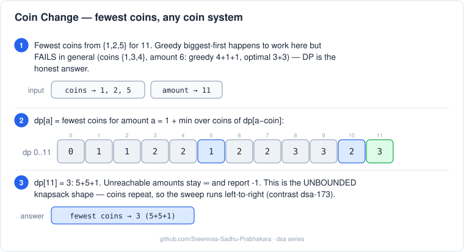

# Coin Change (Min Coins, DP)

> Striver SDE Sheet 178 · Day 26 DP II — per amount, try ending with each coin: 1 + the best for the remainder; upward sweep encodes unlimited reuse. Go, stdlib only, tested.

## Problem

The fewest coins totalling an amount, unlimited supply of each denomination, -1 when impossible. This is the problem #047 warned about: for *arbitrary* coin systems greedy fails — `{1,3,4}` for 6 is the counterexample (greedy 4+1+1 = 3 coins; optimal 3+3 = 2) — so it's DP's turn.

## Approach

`dp[a]` is the fewest coins making amount a. The last coin of an optimal solution is *some* coin c, leaving the optimal solution for a−c — so try every coin: `dp[a] = 1 + min(dp[a−c])`. Sweeping amounts **upward** lets a coin contribute repeatedly (the unbounded-knapsack direction — contrast #173's downward sweep). Unreachable amounts stay at the infinity sentinel, guarded before arithmetic so it never overflows into a fake answer, and surface as -1.

**Complexity:** O(amount · coins) time, O(amount) space.

## Visual walkthrough

Read the picture top to bottom — each numbered frame is one moment of the algorithm
running on this repo's test example.

## Run

    go test ./...   # verify
    go run .        # demo

---

One of 191 repos solving Striver's SDE Sheet in Go — stdlib only, one problem per repo, every solution tested. Browse the set: [`dsa-*` repos](https://github.com/Sreenivas-Sadhu-Prabhakara?tab=repositories&q=dsa-&type=source).
